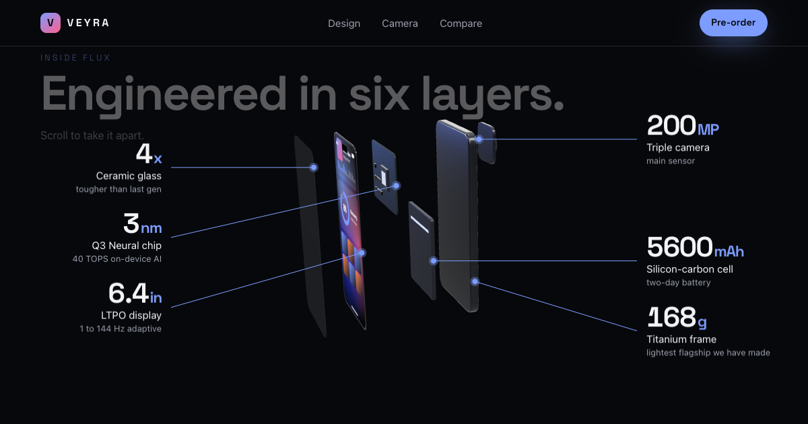

# ScrollCraft: Gadget Launch

A free, open-source **scroll-driven product launch template** for phones and gadgets. Scroll is the
playhead: a procedurally modelled 3D phone rises and turns, its screen runs a live mini OS, it
explodes into six layers with counting spec callouts, recolours itself, and hands off to a camera
section where scrolling is the zoom ring.

**Live demo:** _coming soon_



> Veyra and Flux are fictional. No real brand, product or logo is used or imitated.

## Features

- **3D hero** (Three.js): a phone built entirely from extruded shapes (no model files) with
  physical metal and glass materials, lit by a procedural room environment. It rises and rotates
  from back to front as you scroll.
- **Live screen**: the display is a `CanvasTexture` drawn every frame. Lock screen, then a home
  feed (weather, calendar, animated music waveform, health ring, photos) that scrolls inside the
  device in sync with the page.
- **Exploded view**: glass, display, logic board, battery, camera module and titanium back
  separate along the depth axis. Spec callouts are pinned to projected 3D anchors with leader
  lines and count up as each layer flies out.
- **Huge-type spec filmstrip**: giant numbers slide sideways on a pinned, scrubbed track.
- **Finish picker**: an accessible radio group that tweens the device material and the page
  accent (`--accent`) together.
- **Camera section**: a procedural night city on canvas. Scrolling zooms from 1x to 10x while the
  skyline melts into bokeh discs and the subject stays sharp. Viewfinder HUD included.
- **Compare models** and a **pre-order** finale with per-letter mega type.
- **Lenis** smooth scroll + **GSAP ScrollTrigger**, one pose track that maps scroll to the phone's
  position, rotation, explode amount and screen state.
- **Mobile-first**: separate mobile poses, lower pixel ratio, no MSAA, fewer segments and lights.
  Tested at 390px wide.
- **Reduced motion**: with `prefers-reduced-motion`, there is no smooth scroll, pinning or scrubbing;
  the page becomes a calm static layout with all specs visible.
- **Fast first paint**: the Three.js chunk is lazy-loaded after the text renders. No images,
  video or model files; total built size is under 1 MB.

## Customise (rebrand in one file)

Everything you can read on the page lives in [`src/content.json`](src/content.json):

| Key | What it controls |
| --- | --- |
| `meta` | `<title>`, description, theme colour, language (injected into `index.html` at build) |
| `brand` | Brand name, product name, logo letter |
| `nav` | Nav links and CTA |
| `hero` | Eyebrow, the giant title word (each letter animates), subtitle |
| `screen.steps` | The copy steps shown while the in-device feed scrolls |
| `screen.ui` | What the phone's screen shows: time, date, greeting, weather, music, health, events |
| `explode.layers` | Six spec callouts. `id` must be one of `glass`, `display`, `chip`, `battery`, `camera`, `back`. List them front to back: the first half goes in the left column. `value` + `decimals` drive the counter. |
| `specs.items` | The giant filmstrip numbers |
| `colors.finishes` | Device finishes: `body` is the metal colour, `accent` re-themes the whole page |
| `camera` | Copy, max zoom readout, aperture label, stats |
| `compare.models` | Model cards; `highlight: true` adds the glow and `badge` |
| `preorder`, `footer` | Finale copy, CTAs, fine print |

Want to go further?

- **Motion**: `src/scene/poses.ts` holds the phone's journey as keyframes anchored to sections
  (`['explode', 0.7]` means 70% through the explode section). Add a `mobile` override per keyframe.
- **Section lengths**: the `height` of each `.sec--*` in `src/style.css` sets how long it stays pinned.
- **Model**: `src/scene/Phone.ts` (dimensions in `DIM`, materials, layer explode distances).
- **Screen UI**: `src/scene/screenUI.ts` draws the OS with the 2D canvas API.

## Run

```bash
pnpm install
pnpm dev        # local dev server
pnpm build      # type-check + production build into dist/
pnpm preview    # serve the production build
```

Deploys as a static site anywhere (Vercel, Netlify, GitHub Pages). On Vercel the Vite preset is
detected automatically.

## Project structure

```
src/
  content.json        all copy, prices, colours (edit this)
  types.ts            typed view of content.json
  render.ts           builds semantic HTML from content
  main.ts             Lenis, ScrollTrigger choreography, wiring
  scene/
    Stage.ts          renderer, lights, environment, frame loop
    Phone.ts          procedural six-layer phone
    poses.ts          scroll -> pose keyframe track
    screenUI.ts       live on-device UI drawn to a canvas texture
  sections/
    explode.ts        projected spec callouts + counters
    colors.ts         accessible finish picker with colour tweening
    camera.ts         procedural zoom + bokeh scene
```

## Credits

- [Three.js](https://threejs.org) (MIT), [GSAP + ScrollTrigger](https://gsap.com) (free standard
  license), [Lenis](https://github.com/darkroomengineering/lenis) (MIT), [Vite](https://vite.dev) (MIT).
- [Space Grotesk](https://fonts.google.com/specimen/Space+Grotesk) by Florian Karsten, SIL Open Font
  License, via Fontsource.
- All visuals (3D phone, screen UI, city scene, icons) are procedural and made for this template.
  No third-party photos, videos, models or HDRIs.

## License

[MIT](LICENSE). Use it for anything, credit appreciated.
